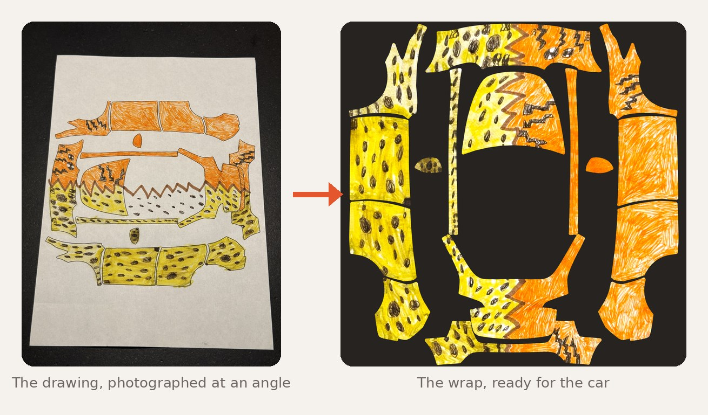
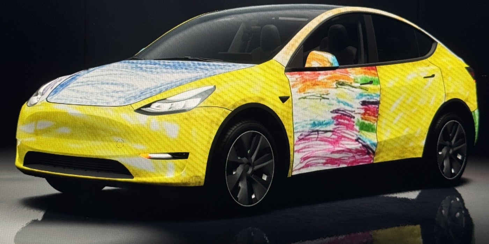
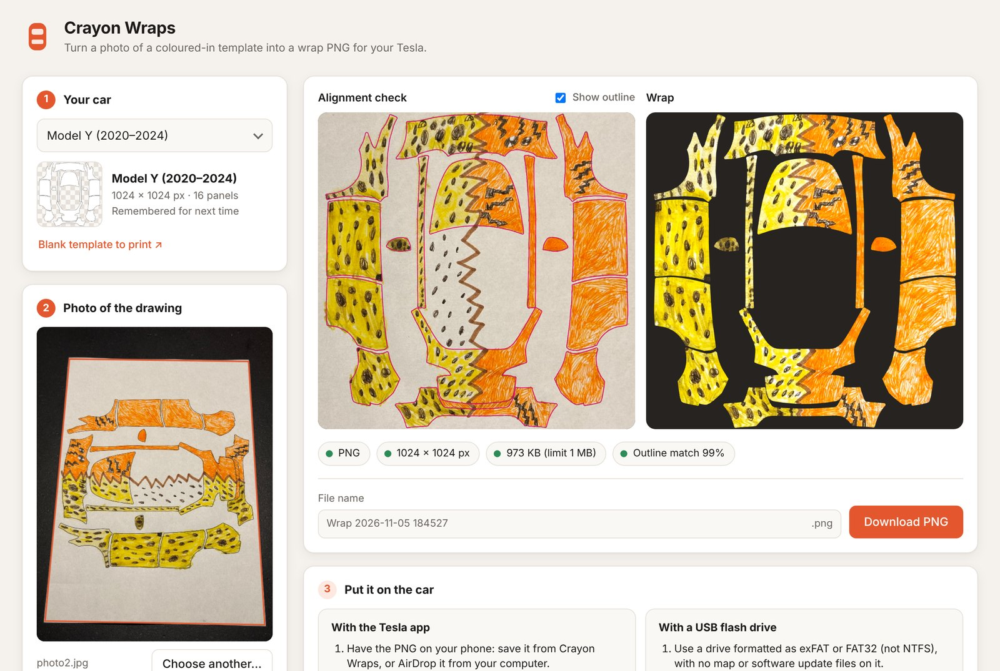
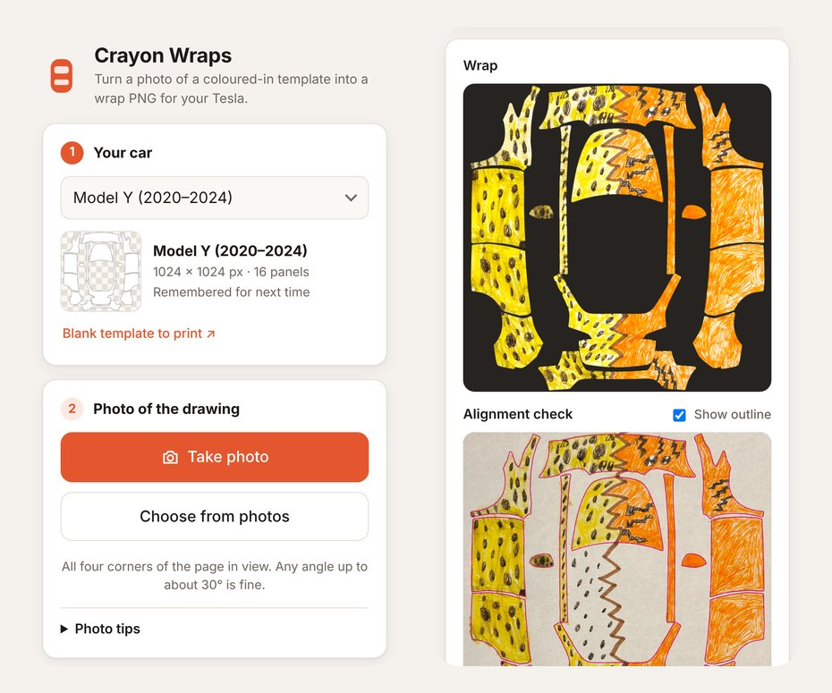

# Crayon Wraps

**Turn your kids' coloured-in Tesla wrap templates into a real wrap for the car.**

Print the blank template for your car, hand over the crayons, take a photo, and Crayon Wraps turns it into a PNG you can load straight into the car's Paint Shop.

### 👉 [Open Crayon Wraps](https://cjborchert.github.io/tesla-crayon-wraps/)

Works in any modern browser on a phone, tablet or computer. Nothing to install, and your photos never leave your device.

## Why this exists

Tesla publishes blank wrap templates for every model in [teslamotors/custom-wraps](https://github.com/teslamotors/custom-wraps). I printed one, and my child took it from there: rainbow doors, racing numbers, lightning bolts, and this cheetah/tiger, the favourite so far. Seeing their own drawing on the car's screen is the best part, and now every new drawing wants its turn.

<em>One of the drawings on the car's screen</em>

Turning a crumpled, colourful sheet of paper into a clean wrap file by hand is fiddly, though. Kids (happily) colour over the lines, the photo is never quite straight, and the colours have to land on exactly the right panels. Crayon Wraps does all of that in about 10 seconds.

## How it works

1. **Print the blank template** for your car from [Tesla's custom-wraps page](https://github.com/teslamotors/custom-wraps) (A4 or Letter, fit to page). The app also has a link to it.
2. **Colour it in.** Going over the lines is fine.
3. **Take a photo** with the whole page in view. Any angle up to about 30° works, so you can tilt the phone to avoid glare.
4. **Open [Crayon Wraps](https://cjborchert.github.io/tesla-crayon-wraps/)**, choose your car and add the photo.
5. **Save the PNG** and put it on the car (see below).

### What happens to the photo

- Finds the sheet of paper and straightens it, whatever the angle.
- Lines up the printed outline with Tesla's template, including a gentle local correction for curled paper or lens distortion. The *alignment check* view shows how well it fits.
- Fills every panel using only the colouring from inside that panel's own outline, so scribbles over the lines don't bleed into the neighbouring panel. The crayon texture is kept.
- Evens out shadows and white balance, so the paper comes out white and the colours look like the drawing.
- Keeps the template's transparency exactly, and keeps the file within Tesla's 1 MB limit.

## Put it on the car

**With the Tesla app** (version 4.59 or later): **Creations → Wrap → Upload** and pick the PNG. The app holds up to 10 wraps.

**With a USB flash drive**, for more wraps: format the drive as exFAT or FAT32 (not NTFS), make a folder called `Wraps` at the top level, and copy up to 10 PNGs into it. Leave map or software update files off the drive.

Then in the car: **Toybox → Paint Shop → Wraps**. Tesla's full instructions are in [teslamotors/custom-wraps](https://github.com/teslamotors/custom-wraps).

## Supported cars

Every model in Tesla's custom-wraps repository: Model 3 (both generations, plus Performance), Model Y (2020–2024 and the 2025+ Standard, Premium and Performance), Model Y L, Model S (2021+ and 2025+ Plaid), Model X (2021+) and Cybertruck. The blank templates load directly from Tesla's repository, so new models show up as soon as they're listed in the app. Any other wrap-template PNG can be used too ("My own template PNG").

## Tips

- **Add it to your Home Screen** (Safari: Share → Add to Home Screen) and it opens like an app, and keeps working offline once you've used it.
- Photograph the page on a surface that isn't white, with a little table showing around the edges.
- On a computer you can drag a photo onto the page, or paste one.

## Privacy

Everything runs in your browser. Photos and wraps are never uploaded anywhere. The only network requests are for the app itself and the blank template from Tesla's GitHub.

## Development

The app is a single static page with no dependencies.

- `src/engine.js`: the image processing (page detection, alignment, panel filling, PNG encoding)
- `src/app.html`: the interface
- `python3 build.py`: builds `index.html`, `sw.js` and `manifest.webmanifest` from `src/`

GitHub Pages serves the repository root.

## Licence

The code is free and unencumbered software released into the public domain ([The Unlicense](LICENSE)): use it, copy it, change it, share it.
The example drawing, the screenshots and the car photo in `docs/` are not part of that dedication.

---

Not affiliated with or endorsed by Tesla. Blank templates © Tesla, loaded from [teslamotors/custom-wraps](https://github.com/teslamotors/custom-wraps).
